# Informe técnico del Reto 4: clúster Docker Swarm en AWS

## Metadata del proyecto

| Campo | Valor |
|---|---|
| Proyecto | Reto 4: despliegue de una aplicación web en Docker Swarm |
| Grupo | Grupo 1 |
| Módulo | Administración de Sistemas Informáticos en Red (ASIR) |
| Plataforma cloud | AWS Academy Learner Lab |
| Región | `us-east-1` |
| Infraestructura | Terraform |
| Orquestación | Docker Swarm |
| Aplicación | Web estática F1 Bilbao |
| Registro de imágenes | Docker Hub |
| Usuario de Docker Hub | `lopiasir` |
| Red de aplicación | Overlay externa `red-g1` |
| MTU de la red overlay | `1450` |
| Servicio Swarm | `f1-bilbao_web` |

> **Criterio documental.** Este informe distingue entre la configuración
> presente en los archivos del repositorio y las operaciones que deben
> realizarse manualmente durante la práctica. No se consideran evidencias
> válidas los valores de ejemplo (`<IP_...>`, `<TOKEN_...>`) hasta que se
> sustituyan por los valores obtenidos durante la ejecución.

---

## 1. Introducción y objetivos

### 1.1. Introducción técnica

Con motivo de la celebración del Gran Premio de Euskadi del Campeonato del Mundo de F1 en el nuevo circuito de Bilbao[cite: 18], el presente proyecto desarrolla la infraestructura cloud necesaria para alojar la web oficial del evento, garantizando su disponibilidad y rendimiento ante los picos de tráfico durante la competición.

El objetivo del Reto 4 es desplegar una aplicación web estática en una
arquitectura distribuida de cuatro instancias EC2. Terraform se utiliza como
herramienta de infraestructura como código (IaC) para declarar y provisionar
los recursos de AWS. Sobre las instancias provisionadas se instala Docker y
se forma un clúster Docker Swarm compuesto por un nodo manager y tres nodos
worker.

El manager mantiene el estado del clúster, coordina el planificador y expone
la información de servicios y nodos. Los workers ejecutan las tareas
programadas. La aplicación se publica mediante el *routing mesh* de Swarm,
por lo que el puerto HTTP publicado puede recibir tráfico en cualquiera de
los nodos, aunque la réplica concreta se ejecute en otro.

La comunicación de control y de datos se realiza utilizando las IP privadas
de las instancias. La red de aplicación `red-g1` es una red overlay externa
al archivo Compose. Se crea manualmente en el manager con una MTU de `1450`
para adaptar el tráfico encapsulado a la red subyacente de AWS y reducir el
riesgo de fragmentación.

La imagen de la aplicación se construye a partir del `Dockerfile` local,
usando Nginx `1.27-alpine` como servidor web. El argumento de compilación
`IMAGE_VERSION` permite publicar las etiquetas `1.0` y `2.0` en Docker Hub.
La propia aplicación expone la versión mediante `version.txt`, y Nginx añade
la cabecera `X-Container-Hostname`, que permite observar qué réplica atiende
cada solicitud.

### 1.2. Objetivo general

Diseñar, desplegar y verificar una arquitectura cloud reproducible para
ejecutar una web versionada en Docker Swarm sobre AWS, utilizando Terraform
para el aprovisionamiento y mecanismos nativos de Swarm para balanceo,
escalado, autorreparación, actualización progresiva y rollback.

### 1.3. Objetivos específicos

1. Utilizar AWS Academy Learner Lab en la región `us-east-1`.
2. Provisionar automáticamente cuatro instancias EC2 mediante Terraform.
3. Configurar el acceso administrativo mediante claves SSH.
4. Instalar Docker en las instancias mediante `user_data`.
5. Inicializar Swarm anunciando la IP privada del manager.
6. Incorporar tres workers al clúster usando el token de unión.
7. Crear la red overlay externa `red-g1` con MTU `1450`.
8. Construir y publicar `lopiasir/f1-bilbao:1.0` y
   `lopiasir/f1-bilbao:2.0`.
9. Desplegar cuatro réplicas mediante `docker stack deploy`.
10. Verificar el routing mesh y el balanceo mediante
    `X-Container-Hostname`.
11. Validar escalado, self-healing, mantenimiento, rolling update y rollback.
12. Analizar la tolerancia a fallos de los workers y el consenso Raft.

---

## 2. Arquitectura de la infraestructura y gestión de sesión

### 2.1. Topología prevista

Terraform declara una instancia manager y tres instancias worker. El nombre
de cada recurso se construye con la variable `grupo`, cuyo valor por defecto
es `1`.

| Nodo lógico | Hostname esperado | Cantidad | Tipo EC2 | Disco raíz | Rol |
|---|---|---:|---|---:|---|
| Manager | `manager-g1` | 1 | `t3.medium` | 20 GB `gp2` | Control plane de Swarm |
| Worker 1 | `worker1-g1` | 1 | `t3.small` | 10 GB `gp2` | Ejecución de tareas |
| Worker 2 | `worker2-g1` | 1 | `t3.small` | 10 GB `gp2` | Ejecución de tareas |
| Worker 3 | `worker3-g1` | 1 | `t3.small` | 10 GB `gp2` | Ejecución de tareas |

Todas las instancias tienen `associate_public_ip_address = true` para
permitir la administración desde el entorno de trabajo. Esto no sustituye a
la comunicación interna: el manager debe inicializar Swarm con su
`manager_private_ip` y los workers deben unirse a
`<IP_PRIVADA_MANAGER>:2377`.

Terraform expone los siguientes outputs:

```text
manager_public_ip
manager_private_ip
manager_id
workers_public_ips
workers_private_ips
workers_ids
```

Las IP públicas son dinámicas y pueden cambiar al detener e iniciar una
instancia. Antes de conectarse por SSH o realizar pruebas HTTP deben
consultarse de nuevo los outputs.

### 2.2. Ficheros de infraestructura

| Fichero | Responsabilidad comprobada |
|---|---|
| `ec2-ubuntu/providers.tf` | Declara el proveedor `hashicorp/aws` `~> 6.0` y usa `var.region`. |
| `ec2-ubuntu/variables.tf` | Declara `region`, `grupo`, `ami`, `tipo_manager`, `tipo_worker` y `clave`. |
| `ec2-ubuntu/main.tf` | Crea manager, workers y `aws_key_pair.alumno`. |
| `ec2-ubuntu/security.tf` | Crea el Security Group, reglas de entrada y salida. |
| `ec2-ubuntu/outputs.tf` | Devuelve IPs e identificadores de las instancias. |
| `ec2-ubuntu/nginx.sh` | Script de `user_data`: hostname, zona horaria e instalación de Docker. |

Existe una diferencia relevante entre la interfaz de variables y su uso:
`tipo_manager` y `tipo_worker` están declaradas en `variables.tf`, pero
`main.tf` utiliza literalmente `t3.medium` y `t3.small`. Por tanto, cambiar
esas variables no modifica actualmente el tipo de instancia; para hacerlo
sería necesario ajustar `main.tf`.

### 2.3. Security Group y puertos

El recurso `aws_security_group.web` se llama `swarm-g${var.grupo}`. La
configuración actual permite todo el tráfico de salida
(`0.0.0.0/0`, protocolo `-1`) y declara las siguientes entradas:

| Puerto | Protocolo | Uso | Configuración actual |
|---:|---|---|---|
| 22 | TCP | Administración SSH | Abierto desde `0.0.0.0/0` |
| 80 | TCP | HTTP de la aplicación | Abierto desde `0.0.0.0/0` |
| 443 | TCP | HTTPS | Abierto desde `0.0.0.0/0`; no hay TLS configurado en Nginx |
| 8080 | TCP | Aplicación auxiliar | Abierto desde `0.0.0.0/0`; no lo usa el Compose actual |
| 2377 | TCP | Gestión/control de Swarm | Abierto desde `0.0.0.0/0` |
| 7946 | TCP | Descubrimiento y comunicación de nodos | Abierto desde `0.0.0.0/0` |
| 7946 | UDP | Descubrimiento y comunicación de nodos | Abierto desde `0.0.0.0/0` |
| 4789 | UDP | VXLAN de redes overlay | Abierto desde `0.0.0.0/0` |

Para una configuración de producción o una entrega endurecida, la política
de mínimos debería restringir:

- SSH (`22`) a la IP o CIDR del entorno de administración.
- `2377`, `7946` y `4789` al CIDR privado de la VPC o a los grupos de
  seguridad de los nodos.
- HTTP (`80`) únicamente a los clientes o rangos que deban acceder a la web.
- `443` solo si se configura realmente HTTPS.
- `8080` si existe un servicio que lo utilice.

Esta restricción no está implementada en los `.tf` actuales y, por tanto,
queda como mejora de seguridad, no como una característica ya aplicada.

### 2.4. Gestión de la sesión de AWS Academy Learner Lab

Las credenciales del Learner Lab son temporales. Antes de cada sesión:

1. Iniciar AWS Academy y pulsar **Start Lab**.
2. Abrir **AWS Details**.
3. Copiar las credenciales temporales proporcionadas por el laboratorio.
4. Actualizar el perfil utilizado por el AWS CLI en
   `~/.aws/credentials`.
5. Verificar la identidad y la región activa:

```bash
aws sts get-caller-identity
aws configure get region
export AWS_DEFAULT_REGION=us-east-1
```

El proveedor de Terraform recibe la región mediante `var.region`, cuyo
valor por defecto es `us-east-1`. El cambio de credenciales no modifica las
instancias ya creadas, pero sí es necesario para ejecutar nuevas operaciones
de Terraform o consultar AWS.

Después de renovar una sesión o reiniciar instancias, se deben consultar las
IPs:

```bash
cd ec2-ubuntu
terraform output manager_public_ip
terraform output manager_private_ip
terraform output workers_public_ips
terraform output workers_private_ips
```

No se deben incluir en Git las claves privadas, los valores de acceso
temporales ni los ficheros de estado de Terraform. El repositorio incluye
un `.gitignore` local con exclusiones para `.terraform`, `*.tfstate` y
`*.tfstate.*`; debe comprobarse que dicho fichero se conserva versionado y
que no se publican estados con información sensible.

---

## 3. Desarrollo por fases

## Fase 0. Codespaces y repositorio

### Objetivo de la fase

Preparar un entorno reproducible de trabajo con VS Code/Codespaces,
Terraform y AWS CLI, y dejar identificada la estructura real del proyecto.

### Procedimiento y comandos

El fichero `.devcontainer/devcontainer.json` utiliza la imagen base:

```text
mcr.microsoft.com/devcontainers/base:ubuntu
```

Y habilita estas features:

```text
ghcr.io/devcontainers/features/aws-cli:1
ghcr.io/devcontainers/features/terraform:1
```

La extensión de VS Code declarada es `hashicorp.terraform`. Desde la raíz
del repositorio se puede inspeccionar la estructura con:

```bash
find . -maxdepth 3 -type f -not -path './.git/*' -print | sort
git status --short
```

La estructura relevante es:

```text
.
├── .devcontainer/devcontainer.json
├── ec2-ubuntu/
│   ├── .terraform.lock.hcl
│   ├── main.tf
│   ├── nginx.sh
│   ├── outputs.tf
│   ├── providers.tf
│   ├── security.tf
│   ├── terraform.tfstate
│   ├── terraform.tfstate.backup
│   └── variables.tf
├── config__nginx/default.conf
├── web/
├── app/
│   ├── Dockerfile
│   └──  docker-compose.yml
│   └── .dockerignore
├── probar-balanceo.sh
├── README.md

```

El `.dockerignore` existente contiene:

```text
.git
.gitignore
.terraform
*.tfstate
*.tfstate.*
```

Esto impide copiar el historial Git, el directorio de trabajo de Terraform
y sus estados al contexto de construcción de Docker. El estado
`terraform.tfstate` debe considerarse sensible aunque esté excluido del
contexto Docker.

### Explicación técnica

El Dev Container evita que las diferencias entre equipos afecten a
Terraform y AWS CLI. La extensión de Terraform aporta resaltado y soporte
del lenguaje, mientras que las features instalan las herramientas sin
añadir comandos de instalación manual al repositorio.

El estado de Terraform contiene identificadores, direcciones y metadatos de
recursos. No debe publicarse en un repositorio público ni compartirse junto
con credenciales. En el árbol de trabajo analizado aparecen
`terraform.tfstate` y `terraform.tfstate.backup`; deben permanecer fuera de
las confirmaciones. 

### Evidencias y capturas comentadas

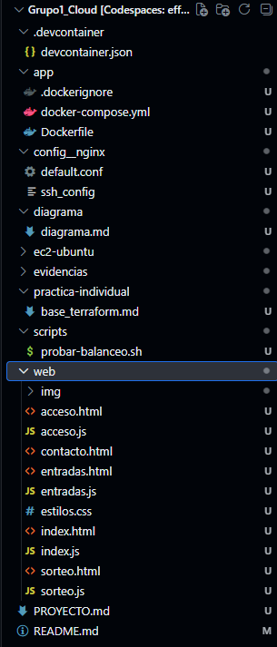

*Figura 0.1. El Dev Container activo muestra la estructura real del repositorio en el explorador, así como las herramientas y extensiones de Terraform preparadas para el despliegue.*


---

## Fase 1. Infraestructura con Terraform

### Objetivo de la fase

Declarar y crear de forma reproducible la infraestructura EC2, la clave
pública y el Security Group de Docker Swarm en `us-east-1`.

### Variables y valores efectivos

Las variables definidas en `ec2-ubuntu/variables.tf` son:

| Variable | Valor por defecto | Uso |
|---|---|---|
| `region` | `us-east-1` | Región del provider AWS |
| `grupo` | `1` | Sufijo de nombres, hostnames y Security Group |
| `ami` | `ami-062944a84867f2386` | AMI Ubuntu 22.04 amd64 declarada |
| `tipo_manager` | `t3.medium` | Declarada, pero no consumida por `main.tf` |
| `tipo_worker` | `t3.small` | Declarada, pero no consumida por `main.tf` |
| `clave` | `grupo1-aws` | Nombre del key pair y fichero público esperado |

Para el Grupo 1, `main.tf` genera los nombres:

```text
manager-g1
worker1-g1
worker2-g1
worker3-g1
swarm-g1
```

### Procedimiento y comandos literales

La clave pública esperada por Terraform es:

```text
~/.ssh/grupo1-aws.pub
```

El fichero privado correspondiente debe protegerse localmente:

```bash
chmod 700 ~/.ssh
chmod 600 ~/.ssh/grupo1-aws
chmod 644 ~/.ssh/grupo1-aws.pub
```

Desde la carpeta Terraform:

```bash
cd ec2-ubuntu
terraform init
terraform fmt -check
terraform validate
terraform plan
terraform apply
```

Para pasar explícitamente los valores del grupo:

```bash
terraform apply \
  -var='grupo=1' \
  -var='clave=grupo1-aws'
```

Después del `apply`:

```bash
terraform output manager_public_ip
terraform output manager_private_ip
terraform output workers_public_ips
terraform output workers_private_ips
terraform output manager_id
terraform output workers_ids
```

Para actualizar la información de recursos existentes:

```bash
terraform refresh
```

Para retirar la infraestructura cuando finalice la práctica:

```bash
terraform destroy
```

### Explicación técnica por fichero

#### `providers.tf`

Declara el provider `hashicorp/aws` con la restricción `~> 6.0` y configura
la región a partir de `var.region`. El fichero `.terraform.lock.hcl`
conserva las selecciones de provider para obtener instalaciones
reproducibles.

#### `variables.tf`

Centraliza región, grupo, AMI y nombre del par de claves. La variable
`ami` fija la imagen declarada para Ubuntu 22.04 en `us-east-1`.

#### `main.tf`

Crea:

- `aws_instance.manager`, con `t3.medium`, disco `gp2` de 20 GB, IP pública,
  Security Group y `user_data`.
- `aws_key_pair.alumno`, leyendo
  `~/.ssh/${var.clave}.pub` mediante `pathexpand`.
- `aws_instance.worker` con `count = 3`, `t3.small`, disco `gp2` de 10 GB,
  IP pública y hostname indexado.

El uso de `count.index + 1` evita duplicar la declaración de los workers.

#### `security.tf`

Crea el grupo `swarm-g1`, una regla de salida completa y las reglas de
entrada descritas en la sección de puertos. Los puertos de Swarm son
necesarios para el manager, el descubrimiento de nodos y el transporte
VXLAN de la red overlay.

#### `outputs.tf`

Expone las IPs públicas para la administración y las IPs privadas para la
configuración de Swarm. Las listas de workers se generan con expresiones:

```hcl
[for w in aws_instance.worker : w.private_ip]
```

#### `nginx.sh`

Aunque su nombre hace referencia a Nginx, el script no instala Nginx. El
`user_data`:

```bash
#!/bin/bash
hostnamectl set-hostname ${hostname}
timedatectl set-timezone Europe/Madrid
apt-get update -y
apt-get install -y docker.io
systemctl start docker
systemctl enable docker
usermod -aG docker ubuntu
```

El script configura el hostname, la zona horaria, instala el paquete
`docker.io`, habilita el servicio y añade `ubuntu` al grupo `docker`.

### Evidencias y capturas comentadas


*Figura 1.1. La salida de `terraform validate` confirma que la configuración declarada es sintácticamente válida.*

---

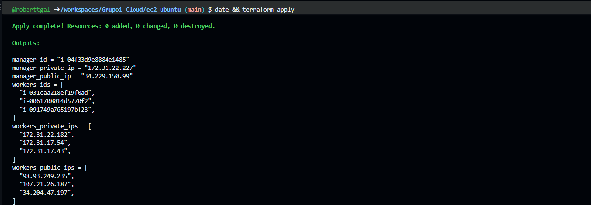

*Figura 1.2. La ejecución de `terraform apply` refleja el aprovisionamiento exitoso de la infraestructura en AWS (manager y tres workers), mostrando además los outputs con las direcciones IP públicas y privadas para la gestión y comunicación del clúster.*

---

## Fase 2. Acceso y administración por SSH

### Objetivo de la fase

Administrar las instancias con una clave SSH, utilizar la IP pública solo
como punto de entrada y mantener las comunicaciones de Swarm sobre IPs
privadas.


### Generación de credenciales SSH

Antes de proceder con el acceso, se generó el par de claves criptográficas en el equipo de administración:

````bash
ssh-keygen -t rsa -b 4096 -N "" -f ~/.ssh/grupo1-aws
````
### Procedimiento operativo 

El acceso básico al manager utiliza el usuario `ubuntu` y la clave declarada:

```bash
ssh -i ~/.ssh/grupo1-aws ubuntu@<IP_PUBLICA_MANAGER>
```

En el repositorio no existe un fichero `~/.ssh/config` ni una configuración
de `sshd_config`. Por ello, la siguiente configuración es una propuesta
operativa que debe crearse manualmente en el equipo de administración y no
se presenta como parte ya implementada:

```sshconfig
Host swarm-manager
    HostName <IP_PUBLICA_MANAGER>
    User ubuntu
    IdentityFile ~/.ssh/grupo1-aws

Host swarm-worker1
    HostName <IP_PRIVADA_WORKER_1>
    User ubuntu
    IdentityFile ~/.ssh/grupo1-aws
    ProxyJump swarm-manager

Host swarm-worker2
    HostName <IP_PRIVADA_WORKER_2>
    User ubuntu
    IdentityFile ~/.ssh/grupo1-aws
    ProxyJump swarm-manager

Host swarm-worker3
    HostName <IP_PRIVADA_WORKER_3>
    User ubuntu
    IdentityFile ~/.ssh/grupo1-aws
    ProxyJump swarm-manager
```

Aplicar permisos restrictivos:

```bash
chmod 700 ~/.ssh
chmod 600 ~/.ssh/config
chmod 600 ~/.ssh/grupo1-aws
```

### Endurecimiento SSH

El Terraform actual solo crea una regla de red para el puerto 22; no
modifica la configuración del servidor SSH. Para cumplir una política de
administración endurecida, comprobar en cada instancia:

```bash
sudo sshd -T | grep -E 'permitrootlogin|passwordauthentication'
```

Los valores esperados son:

```text
permitrootlogin no
passwordauthentication no
```

Si la imagen del laboratorio no los aplica por defecto, el administrador
debe definirlos en `/etc/ssh/sshd_config`, validar y reiniciar el servicio:

```bash
sudoedit /etc/ssh/sshd_config
sudo sshd -t
sudo systemctl restart ssh
```

No se debe cerrar la sesión SSH original hasta comprobar que el acceso con
la clave continúa funcionando.

### Transferencia del Compose

El `docker-compose.yml` no es copiado por Terraform. La transferencia
documentada por el proyecto es:

```bash
scp -i ~/.ssh/grupo1-aws docker-compose.yml \
  ubuntu@<IP_PUBLICA_MANAGER>:/home/ubuntu/docker-compose.yml
```

Después, conectarse al manager y comprobar:

```bash
ssh -i ~/.ssh/grupo1-aws ubuntu@<IP_PUBLICA_MANAGER>
ls -l /home/ubuntu/docker-compose.yml
```

### Explicación técnica

La IP pública permite la administración desde Internet, mientras que
`--advertise-addr` evita que Swarm anuncie una dirección pública para el
tráfico interno. `ProxyJump` permite alcanzar las IPs privadas de los
workers atravesando el manager sin asignar rutas públicas adicionales a
los workers.

### Evidencias y capturas comentadas

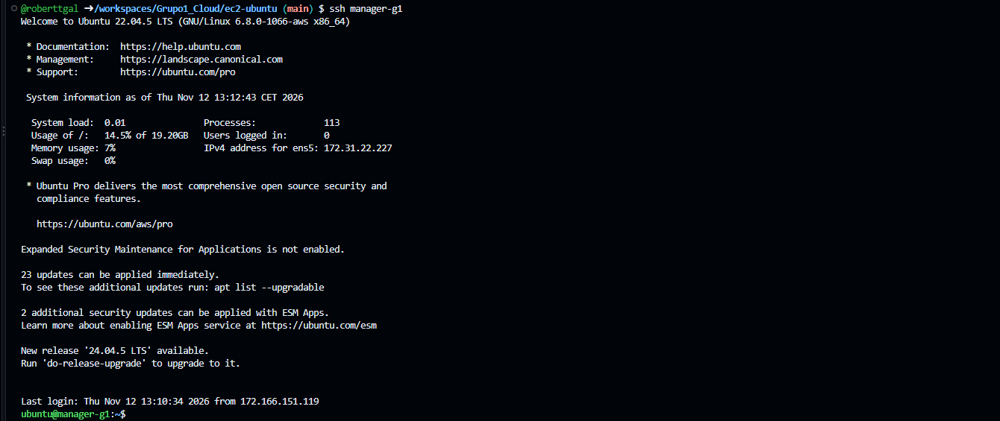

*Figura 2.1. Conexión SSH exitosa al nodo manager (`manager-g1`) utilizando el archivo de configuración simplificado, mostrando el mensaje de bienvenida y el estado del sistema Ubuntu.*

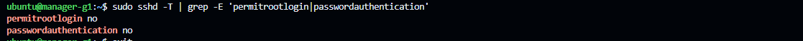

*Figura 2.2. La verificación mediante el comando `sshd -T` confirma que se han aplicado correctamente las políticas de seguridad estricts, deshabilitando el acceso de root (`permitrootlogin no`) y la autenticación por contraseña (`passwordauthentication no`).*


## Fase 3. Clúster Docker Swarm y redes overlay

### Objetivo de la fase

Crear el plano de control de Swarm, unir los tres workers y preparar la red
overlay compartida por las réplicas.

### Inicialización del manager

Desde el manager:

```bash
docker swarm init --advertise-addr <IP_PRIVADA_MANAGER>
docker swarm join-token worker
```

El segundo comando imprime un token y una orden `docker swarm join`. El
token es secreto operativo y no debe incluirse en el repositorio ni en
capturas públicas.

### Unión de los workers

Ejecutar en cada worker:

```bash
docker swarm join \
  --token <TOKEN_WORKER> \
  <IP_PRIVADA_MANAGER>:2377
```

En el manager:

```bash
docker node ls
```

El resultado esperado es un manager `Leader` y tres workers `Ready`.

### Creación de `red-g1`

La red se crea una sola vez en el manager:

```bash
docker network create \
  --driver overlay \
  --attachable \
  --opt com.docker.network.driver.mtu=1450 \
  red-g1
```

Comprobar sus propiedades:

```bash
docker network inspect red-g1
```


### Explicación técnica

`--advertise-addr` indica la dirección que el manager anuncia a los demás
nodos. Usar la IP privada mantiene el tráfico del control plane dentro de la
red de AWS y evita depender de la traducción o accesibilidad de las IPs
públicas.

Docker Swarm utiliza:

- TCP `2377` para la gestión del clúster.
- TCP/UDP `7946` para descubrimiento y comunicación entre nodos.
- UDP `4789` para VXLAN, usado por las redes overlay.

La red overlay encapsula tráfico de contenedores sobre la red física. La
opción `com.docker.network.driver.mtu=1450` deja margen para las cabeceras
de encapsulación VXLAN y reduce la posibilidad de fragmentación. La opción
`--attachable` permite conectar contenedores independientes a la red además
de las tareas de servicios Swarm.

### Evidencias y capturas comentadas

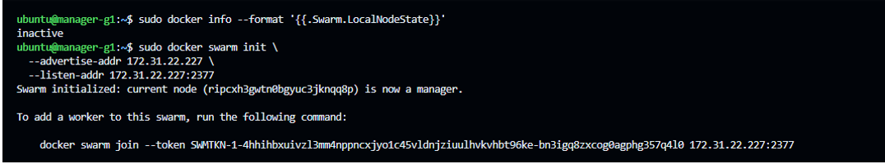

*Figura 3.1. El manager inicializa Swarm anunciando su IP privada y genera
el token de unión para los workers.*

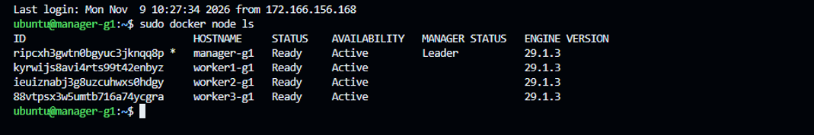

*Figura 3.2. `docker node ls` muestra el manager líder y los tres workers
en estado `Ready`.*

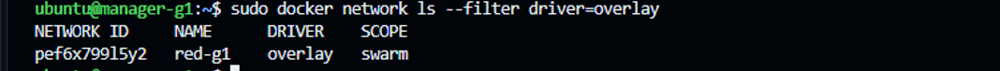

*Figura 3.3. La inspección de `red-g1` confirma el driver overlay, el
carácter externo y la configuración de MTU 1450.*

---

## Fase 4. Aplicación web e imágenes Docker

### Objetivo de la fase

Empaquetar la web F1 Bilbao, publicar sus versiones en Docker Hub y
desplegarla como servicio replicado en Swarm.

### Estructura de la aplicación

La carpeta `web/` contiene las páginas y recursos estáticos, entre ellos:

```text
web/
├── index.html
├── index.js
├── acceso.html
├── acceso.js
├── contacto.html
├── entradas.html
├── entradas.js
├── sorteo.html
├── sorteo.js
├── estilos.css
└── img/
```

La carpeta `nginx/` contiene:

```text
nginx/default.conf
```

Su configuración escucha en los puertos 80 de IPv4 e IPv6, sirve
`/usr/share/nginx/html` y añade:

```nginx
add_header X-Container-Hostname $hostname always;
```

El `try_files` devuelve el recurso solicitado o `404`.

### Construcción de la imagen

El `Dockerfile` utiliza:

```dockerfile
FROM nginx:1.27-alpine
ARG IMAGE_VERSION=dev
```

La construcción copia `web/` a `/app/`, sustituye el document root de Nginx
por un enlace simbólico a `/app`, copia la configuración y genera
`/app/version.txt` a partir de `IMAGE_VERSION`. También declara:

- `EXPOSE 80`.
- Healthcheck HTTP contra `127.0.0.1`.
- Labels OCI de título, descripción y versión.

Construir y publicar:

```bash
docker login

docker build \
  --build-arg IMAGE_VERSION=1.0 \
  -t lopiasir/f1-bilbao:1.0 .
docker push lopiasir/f1-bilbao:1.0

docker build \
  --build-arg IMAGE_VERSION=2.0 \
  -t lopiasir/f1-bilbao:2.0 .
docker push lopiasir/f1-bilbao:2.0
```

Las referencias de Docker Hub son:

- [lopiasir/f1-bilbao:1.0](https://hub.docker.com/r/lopiasir/f1-bilbao/tags?name=1.0)
- [lopiasir/f1-bilbao:2.0](https://hub.docker.com/r/lopiasir/f1-bilbao/tags?name=2.0)

### Despliegue del stack

El archivo `docker-compose.yml` define el servicio `web` con imagen inicial
`lopiasir/f1-bilbao:1.0`:

```yaml
deploy:
  replicas: 4
  restart_policy:
    condition: on-failure
```

El puerto 80 del contenedor se publica en el 80 del nodo con `mode: ingress`.
La red `red-g1` se marca como externa, por lo que debe existir antes del
despliegue.

Desde el manager:

```bash
docker login
docker stack deploy \
  --with-registry-auth \
  --compose-file docker-compose.yml \
  f1-bilbao

docker service ls
docker service ps f1-bilbao_web
```

El nombre completo `f1-bilbao_web` combina el nombre del stack y el nombre
del servicio. `--with-registry-auth` distribuye al servicio las
credenciales necesarias para que los nodos puedan extraer la imagen privada
o autenticada del registro.

### Explicación técnica

El *routing mesh* escucha el puerto publicado en cada nodo y reenvía la
petición a una tarea disponible. Por eso se puede probar la aplicación
contra las IPs públicas del manager y de los workers, aunque una réplica no
esté ubicada en el nodo consultado.

La etiqueta de imagen es inmutable desde la perspectiva del despliegue:
`1.0` y `2.0` identifican dos construcciones distintas. `version.txt`
permite comprobar cuál se está ejecutando sin depender de la inspección de
labels del contenedor.

### Evidencias y capturas comentadas

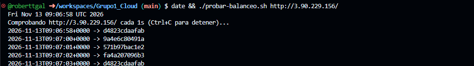
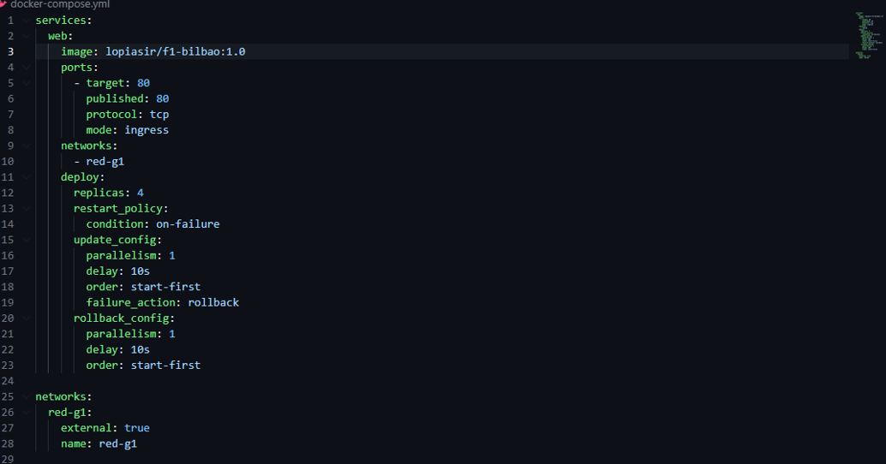
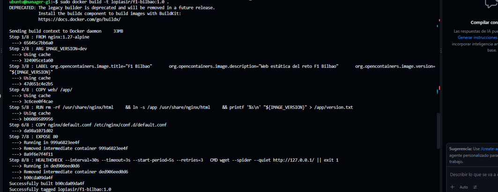

*Figura 4.1. Docker construye la imagen con `IMAGE_VERSION=1.0` y la
publica como `lopiasir/f1-bilbao:1.0`. Realizamos el mismo procedimiento con la Imagen 2.0*

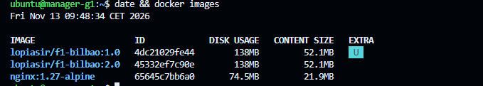

*Figura 4.2. Demostración Imagenes`.*

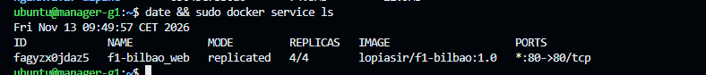

*Figura 4.3. `docker service ls` y `docker service ps` muestran el servicio
`f1-bilbao_web` con cuatro réplicas operativas.*


*Figura 4.4. Vemos la web en una de las maquinas.*

---

## Fase 5. Pruebas de orquestación y alta disponibilidad

### Objetivo de la fase

Demostrar el comportamiento operativo de Swarm ante tráfico distribuido,
variación de capacidad, fallo de contenedores, mantenimiento de nodos,
actualización de versiones y pérdida de un worker.

### 5.1. Balanceo de carga

Antes de probar, comprobar:

```bash
docker service ls
docker service ps f1-bilbao_web
```

Desde el equipo de administración:

```bash
chmod +x probar-balanceo.sh
./probar-balanceo.sh http://<IP_MANAGER>/
```

El script acepta una URL opcional y un intervalo configurable mediante
`INTERVAL`. Cada iteración:

1. Crea un fichero temporal para las cabeceras.
2. Ejecuta `curl --fail --max-time 5`.
3. Extrae `X-Container-Hostname` con `awk`.
4. Imprime timestamp y hostname de la réplica.
5. Elimina el fichero temporal.

También se puede consultar directamente:

```bash
curl -i http://<IP_MANAGER>/
curl http://<IP_MANAGER>/version.txt
```

**Evidencia esperada:** varios valores de `X-Container-Hostname` al repetir
peticiones, demostrando que el routing mesh y las réplicas están atendiendo
tráfico.

### 5.2. Escalado dinámico

Registrar el estado inicial:

```bash
docker service ps f1-bilbao_web
```

Escalar sucesivamente:

```bash
docker service scale f1-bilbao_web=8
docker service ps f1-bilbao_web

docker service scale f1-bilbao_web=12
docker service ps f1-bilbao_web

docker service scale f1-bilbao_web=2
docker service ps f1-bilbao_web
```

El scheduler crea o elimina tareas para aproximarse al número solicitado,
respetando los recursos disponibles en los cuatro nodos.

### 5.3. Autorreparación de un contenedor

Identificar una tarea y los contenedores de la aplicación:

```bash
docker service ps f1-bilbao_web
docker ps --filter label=com.docker.swarm.service.name=f1-bilbao_web
```

Eliminar un contenedor concreto:

```bash
docker rm -f <ID_CONTENEDOR>
docker service ps f1-bilbao_web
```

Para observar la reposición:

```bash
watch -n 1 'docker service ps f1-bilbao_web'
```

El `restart_policy` del Compose establece `condition: on-failure`. Además,
el controlador de servicios mantiene el número deseado de réplicas; al
desaparecer una tarea, Swarm programa una sustituta si el nodo y los
recursos lo permiten.

### 5.4. Mantenimiento de nodos

Antes del mantenimiento:

```bash
docker node ls
docker service ps f1-bilbao_web
```

Drenar el worker:

```bash
docker node update --availability drain <NODO_WORKER>
docker node inspect <NODO_WORKER> --pretty
docker service ps f1-bilbao_web
```

Reactivar el worker:

```bash
docker node update --availability active <NODO_WORKER>
docker service ps f1-bilbao_web
```

`drain` impide nuevas tareas y evacua las existentes hacia nodos elegibles.
`active` vuelve a permitir que el scheduler utilice el nodo.

### 5.5. Rolling update de 1.0 a 2.0

Comprobar la versión antes del cambio:

```bash
curl http://<IP_MANAGER>/version.txt
docker service inspect f1-bilbao_web \
  --format '{{.Spec.TaskTemplate.ContainerSpec.Image}}'
```

Aplicar la actualización:

```bash
docker service update \
  --image lopiasir/f1-bilbao:2.0 \
  --with-registry-auth \
  --update-parallelism 1 \
  --update-delay 10s \
  --update-order start-first \
  --update-failure-action rollback \
  f1-bilbao_web
```

Verificar durante y después:

```bash
docker service ps f1-bilbao_web
curl http://<IP_MANAGER>/version.txt
```

`parallelism 1` actualiza una tarea cada vez. `delay 10s` separa las
actualizaciones. `start-first` intenta arrancar la tarea nueva antes de
retirar la anterior, reduciendo el tiempo sin servicio. Si la actualización
falla, `failure_action rollback` solicita la vuelta atrás.

Rollback manual:

```bash
docker service rollback f1-bilbao_web
docker service ps f1-bilbao_web
curl http://<IP_MANAGER>/version.txt
```

### 5.6. Tolerancia a fallos de un worker

Guardar el estado antes de simular la incidencia:

```bash
docker node ls
docker service ps f1-bilbao_web
./probar-balanceo.sh http://<IP_MANAGER>/
```

Detener temporalmente un worker desde AWS Academy o detener Docker en el
worker seleccionado:

```bash
sudo systemctl stop docker
```

Desde otro nodo observar:

```bash
docker node ls
docker service ps f1-bilbao_web
./probar-balanceo.sh http://<IP_MANAGER>/
```

Después de recuperar el worker:

```bash
sudo systemctl start docker
docker node ls
docker service ps f1-bilbao_web
```

La pérdida de un worker no equivale a alta disponibilidad total del control
plane. La configuración actual tiene un único manager; si se pierde ese
manager, no existe otro manager para mantener el consenso ni operar el
clúster. La aplicación puede mantener tareas en workers, pero la capacidad
de gestión queda comprometida.

### 5.7. Elección de líder Raft

Docker Swarm requiere una mayoría de managers para mantener el consenso
Raft. Con un único manager no es posible demostrar una elección entre
managers. Para una práctica con tres managers, la comprobación sería:

```bash
docker node ls
docker node promote <NODO_1> <NODO_2>
docker node ls
docker node demote <MANAGER_NO_LIDER>
docker node ls
```

No se debe detener más de un manager simultáneamente en un clúster de tres,
porque se perdería la mayoría. Esta ampliación no está declarada en el
Terraform actual y debe considerarse una extensión de la arquitectura, no
un resultado del despliegue de Grupo 1.

### Evidencias y capturas comentadas

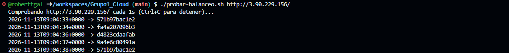

*Figura 5.1. El script `probar-balanceo.sh` registra diferentes valores de
`X-Container-Hostname` al consultar el endpoint HTTP.*

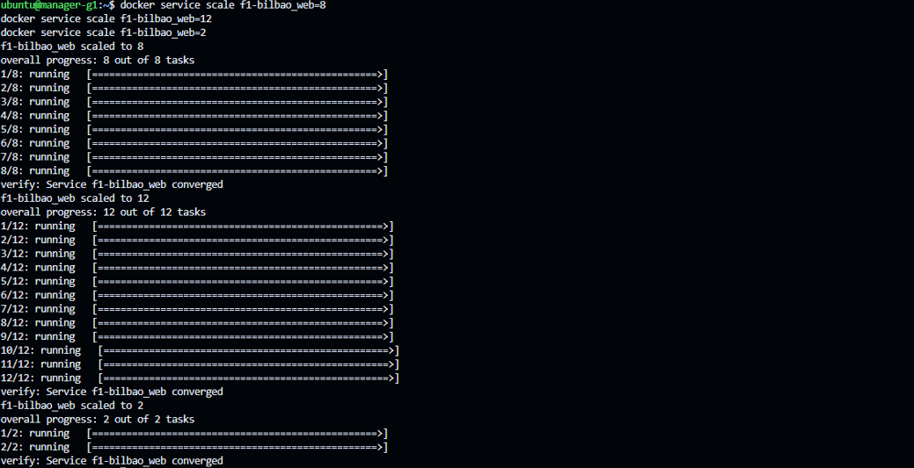

*Figura 5.2. El servicio pasa por 8, 12 y 2 réplicas, y `docker service ps`
refleja las tareas creadas o retiradas.*

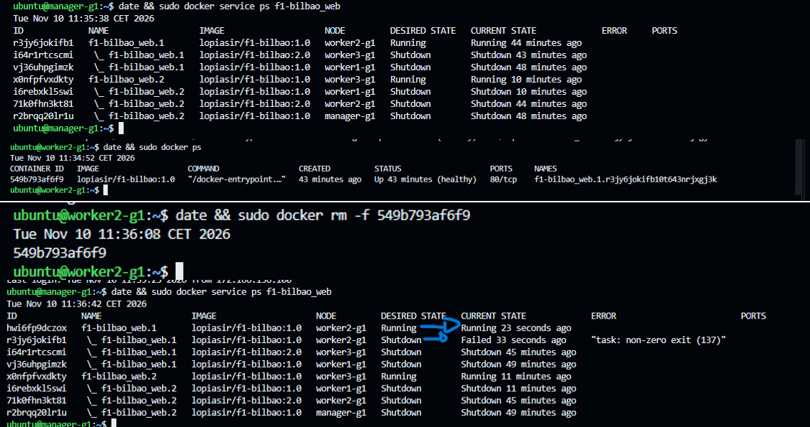

*Figura 5.3. Tras eliminar un contenedor con `docker rm -f`, Swarm crea una
tarea sustituta y recupera el número deseado de réplicas. Vemos el ejemplo del Worker 2*

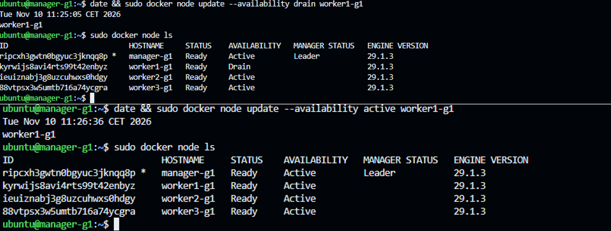

*Figura 5.4. El worker en eAstado `Drain` deja de recibir tareas y, tras
volver a `Active`, puede participar de nuevo en la programación.*

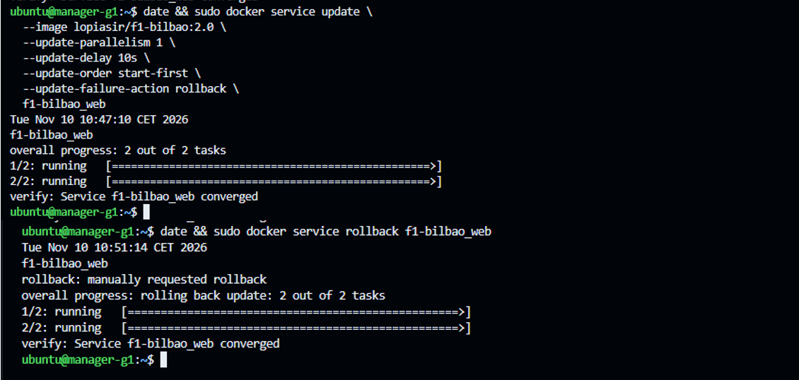

*Figura 5.5. La imagen cambia de `1.0` a `2.0` con actualización progresiva
y la orden `docker service rollback` restaura la versión anterior.*

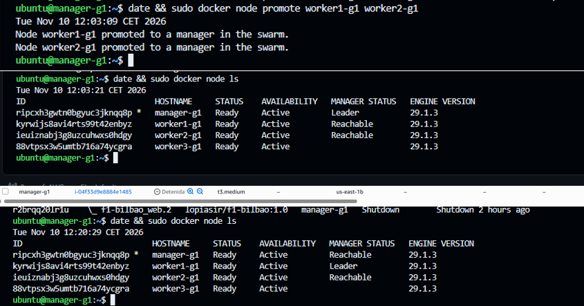

*Figura 5.6. Eleccion de lider (Promote) y consenso Raft en los nodods manager del cluster.*

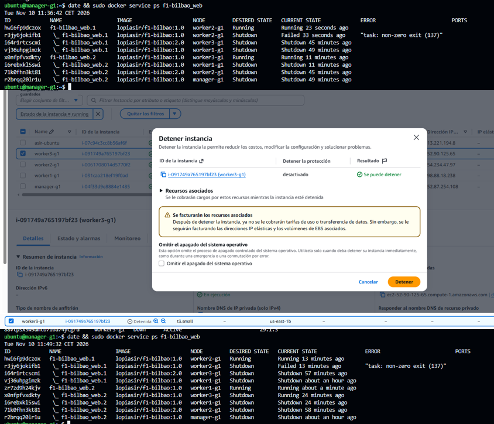


*Figura 5.7. Tolerancia a fallos.
El servicio se observa antes, durante y después de la caída simulada del worker.*

---

## 4. Seguridad, incidencias y conclusiones

## 4.1. Medidas de seguridad

### Credenciales y claves

- Mantener la clave privada `~/.ssh/grupo1-aws` con permisos `600`.
- Mantener `~/.ssh` con permisos `700`.
- No versionar claves privadas, tokens de Swarm ni credenciales de Docker
  Hub.
- Renovar las credenciales temporales de Learner Lab al iniciar cada sesión.
- No guardar credenciales AWS en scripts, Compose o imágenes.
- No incluir `terraform.tfstate` ni `terraform.tfstate.backup` en Git.

### Acceso SSH

- Usar el usuario no root `ubuntu`.
- Verificar `PermitRootLogin no`.
- Verificar `PasswordAuthentication no`.
- Preferir IPs privadas y `ProxyJump` para llegar a los workers.
- Restringir el puerto 22 al origen administrativo en una configuración
  endurecida.

### Red

- Mantener el tráfico interno de Swarm en IPs privadas.
- Restringir `2377`, `7946` y `4789` a la red privada de los nodos.
- Publicar solo el puerto necesario para la web.
- Eliminar reglas de `443` y `8080` si no existe un servicio que las use.
- Mantener la MTU de `1450` en la red overlay.

La configuración existente aplica únicamente una parte de estas medidas:
usa claves para Terraform y SSH, pero las reglas de entrada están abiertas
a `0.0.0.0/0` y no existe configuración SSH versionada que fuerce el
endurecimiento.

## 4.2. Incidencias técnicas y resolución

| Incidencia o riesgo | Causa identificada | Resolución o tratamiento |
|---|---|---|
| IP pública distinta después de reiniciar una EC2 | Las IPs públicas se asignan dinámicamente | Consultar `terraform output` antes de cada acceso o prueba |
| Swarm anuncia una dirección incorrecta | Usar IP pública o no fijar dirección de anuncio | Inicializar con `--advertise-addr <IP_PRIVADA_MANAGER>` |
| El stack no encuentra `red-g1` | El Compose la declara `external: true` | Crear la red antes con `docker network create` |
| Fragmentación del tráfico overlay | Encapsulación VXLAN sobre la red subyacente | Crear `red-g1` con MTU `1450` |
| Los workers no descargan la imagen | El registro requiere autenticación | Usar `docker login` y `--with-registry-auth` |


La tabla recoge tanto incidencias operativas previsibles como diferencias
detectadas al revisar el código. No se afirma que todas se hayan producido
en una ejecución concreta sin una captura o registro que lo demuestre.


## 4.3. Conclusiones técnicas

La infraestructura desarrollada combina automatización avanzada y alta disponibilidad para dar respuesta directa a las exigencias tecnológicas de un evento global de la magnitud de la Fórmula 1 Euskadi. Mediante Terraform se aprovisiona de forma automatizada toda la base en AWS —incluyendo redes, servidores y seguridad—, mientras que Docker Swarm gestiona dinámicamente el ciclo de vida de los contenedores para absorber sin interrupciones las avalanchas masivas de aficionados que consultan clasificaciones, horarios o resultados en directo tras la carrera.

Gracias a la redundancia de los nodos y a la monitorización continua del clúster, la plataforma garantiza una resiliencia total frente a fallos imprevistos o tareas de mantenimiento en directo mediante nodos en estado drain. Esto permite realizar actualizaciones de versión progresivas o aplicar un retroceso (rollback) inmediato si surgiera cualquier incidencia, asegurando una continuidad del servicio del cien por cien y demostrando que la solución ofrece la robustez y tranquilidad necesarias para que la plataforma digital de la carrera funcione a la perfección desde el primer minuto.
